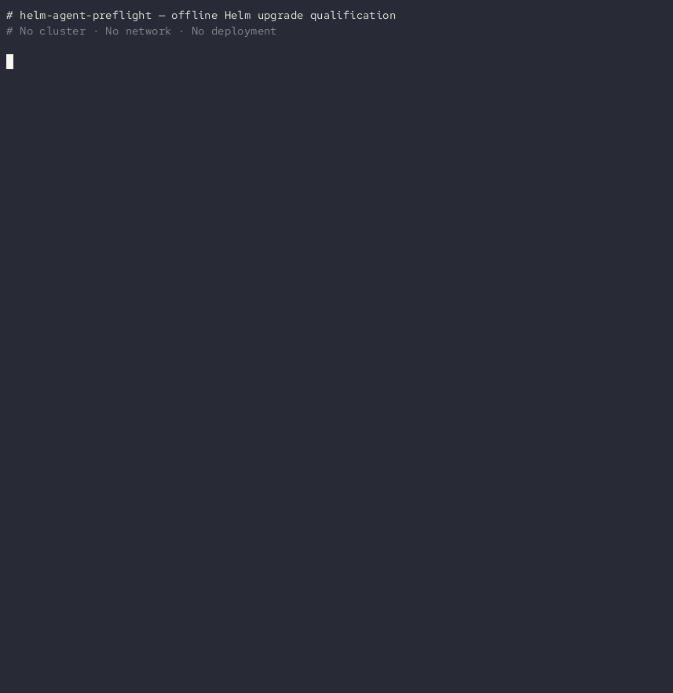
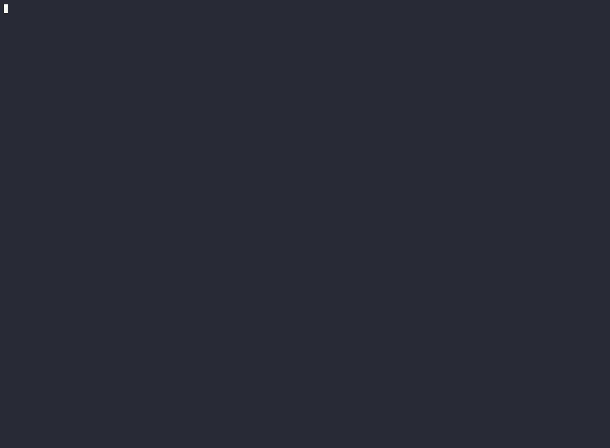

# helm-agent-preflight

Offline Helm upgrade qualification with deterministic security checks.

**Status:** Hackathon MVP (PRD v0.3)

## How it works

```
  Human / CI / AI Agent (OpenCode, Claude Code, …)
         │
         │  "Qualify this Helm upgrade"
         ▼
  ┌──────────────────────────────────────────────────────┐
  │            helm preflight upgrade                    │
  │                                                      │
  │  ① helm template baseline   ──┐                      │
  │  ② helm template candidate  ──┤  diff                │
  │  ③ Δ added / modified / removed resources           │
  │  ④ conftest test  (Rego policies, offline)           │
  │                                                      │
  │  Verdict  : PASS · BLOCK · INDETERMINATE             │
  │  Fingerprint: sha256:…  (tamper-evident)             │
  │  No cluster access · No network · No deployment      │
  └──────────────┬───────────────────────────────────────┘
                 │  Versioned JSON report
        ┌────────┴──────────┐
        │                   │
     PASS (exit 0)       BLOCK (exit 2)
        │                   │
  Human authorizes    Agent proposes smallest fix
        │             → re-run preflight → PASS
        ▼                   │
  helm upgrade         Human reviews & authorizes
  (actual deploy)
```

## Quick start

```bash
# Install
helm plugin install https://github.com/tosin2013/helm-agent-preflight

# Run offline qualification
helm preflight upgrade \
  --from  ./baseline-chart \
  --to    ./candidate-chart \
  --release-name my-app \
  --namespace    production \
  --kube-version 1.28
```

## Demos

```bash
bash demo.sh            # 6 offline scenarios: PASS, BLOCK, INDETERMINATE, secrets, determinism
bash demo-agent.sh      # AI agent session using OpenCode + SKILL.md protocol
bash demo-minikube.sh   # live cluster demo: preflight blocks bad charts before helm runs
```

### Offline qualification: PASS and BLOCK



### AI agent session (OpenCode + SKILL.md protocol)



<details>
<summary>Re-record or play the terminal recordings</summary>

```bash
# Play locally (pip install asciinema)
asciinema play demos/offline.cast
asciinema play demos/agent.cast

# Re-record casts (headless-safe, no display needed)
make demo-record-asciinema

# Re-render GIFs from casts (requires agg: https://github.com/asciinema/agg)
make demo-render-gif
```

</details>

## What it does

`helm preflight upgrade` renders both a baseline (current) and candidate (new)
Helm chart locally using `helm template`, diffs the resulting Kubernetes
resources, evaluates security invariants against a policy, and emits a versioned
JSON report.

**No cluster access, no network calls, and no deployment occur.**

## What it cannot guarantee

- Production deployment success (offline only)
- Complete Kubernetes security certification
- Safety of configurations not covered by the active policy

## Install

```bash
# 1. Install conftest (required for Rego policy evaluation)
brew install conftest                    # macOS / Linux (Homebrew)
# or: https://www.conftest.dev/install/

# 2. Install the Helm plugin
helm plugin install https://github.com/tosin2013/helm-agent-preflight
```

The install hook downloads the platform binary from GitHub Releases automatically.

**Build from source:**

```bash
git clone https://github.com/tosin2013/helm-agent-preflight
cd helm-agent-preflight
make build
helm plugin install .
```

## Usage

```bash
helm preflight upgrade \
  --from        ./examples/safe-upgrade/baseline \
  --to          ./examples/safe-upgrade/candidate \
  --release-name my-release \
  --namespace   production \
  --kube-version 1.28 \
  [--values     values.yaml] \
  [--policy     policies/baseline.yaml] \
  [--output-file report.json]
```

## Exit codes

| Code | Meaning |
|------|---------|
| 0 | PASS — all configured offline checks passed |
| 2 | BLOCK — at least one enforced policy was violated |
| 3 | INDETERMINATE — required verification could not be completed |
| 4 | Error — tool execution failure |

## Security rules (P0)

| Rule | Trigger | Verdict |
|------|---------|---------|
| RBAC-001 | Wildcard `*` in ClusterRole/Role resources | BLOCK |
| RBAC-002 | Wildcard `*` in ClusterRole/Role verbs | BLOCK |
| WORK-001 | `securityContext.privileged=true` | BLOCK |
| WORK-002 | `spec.hostNetwork=true` | BLOCK |
| WORK-003 | `spec.hostPID=true` | BLOCK |
| WORK-004 | `spec.hostIPC=true` | BLOCK |
| WORK-005 | hostPath volume mount | BLOCK |
| WORK-006 | `allowPrivilegeEscalation=true` | BLOCK |
| HOOK-001 | Upgrade hook without hook-delete-policy | WARN |

Pre-existing violations (present in both baseline and candidate) are reported but
do not change PASS to BLOCK — only newly introduced violations cause BLOCK.

## Example output

```json
{
  "schema_version": "1.0.0",
  "verdict": "BLOCK",
  "security_findings": [
    {
      "rule_id": "RBAC-001",
      "severity": "CRITICAL",
      "object": {"kind": "ClusterRole", "name": "my-release-admin"},
      "message": "Wildcard (*) in RBAC resources grants access to all resource types",
      "verdict_contribution": "BLOCK",
      "pre_existing": false
    }
  ],
  "fingerprint": "a3f9c1b8...",
  "run_metadata": {"no_cluster_credentials": true, "no_deployment_occurred": true}
}
```

## Human runnable

No LLM or API key required. Any human can run `helm preflight upgrade` directly.

## Agent skill

See `skills/helm-preflight/SKILL.md` for the portable AI agent skill.

## License

Apache-2.0 — Copyright The helm-agent-preflight Authors
